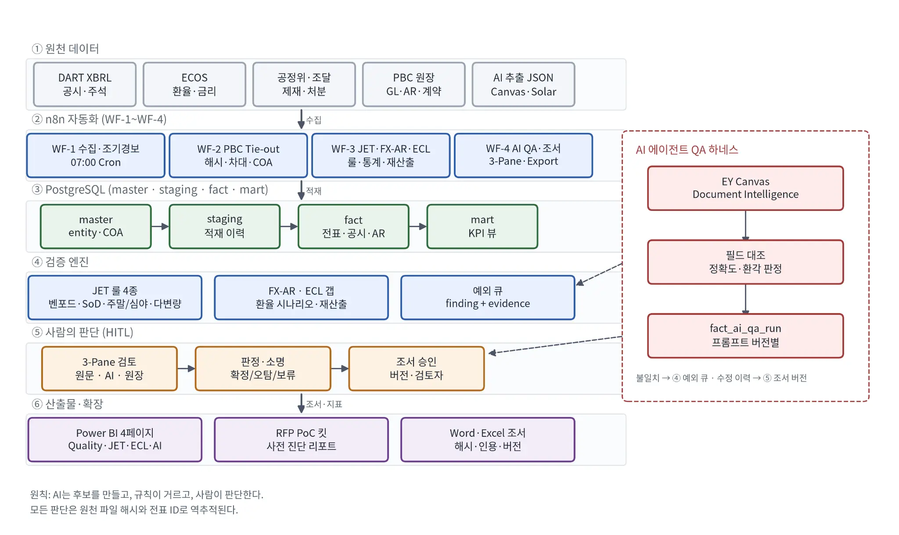

# Aegis-Guard Architecture v2 — 구현 기준선

이 문서는 제출 제안서와 저장소 구현을 1:1로 맞추기 위한 기준 문서다. 이후 기능은 이 구조에서 빠진 블록을 채우는 방식으로 추가하며, 임의로 합성 데이터 데모만 완성품처럼 표현하지 않는다.



## 1. 원천 데이터 계층

| 제안서 블록 | 구현 계약 | 현재 상태 |
|---|---|---|
| DART XBRL·공시·주석 | 공시 이벤트와 XBRL/주석 원문을 원문 해시와 함께 수집·staging | WF-1 공시목록 API 연결; XBRL/주석 adapter 추가 대상 |
| ECOS 환율·금리 | 관측일·지표코드·값·출처시각을 `fact_macro_ecos`에 적재 | 테이블·합성 seed 존재; 실제 API adapter 추가 대상 |
| 공정위·조달 제재·처분 | 사업자번호·처분일·제재유형·원문 locator를 staging/fact에 적재 | `fact_sanction_event` 공통 계약 추가; upstream adapter/live key 대기 |
| PBC 원장 GL·AR·계약 | 파일 intake·SHA-256·행수·tie-out 상태와 conformed fact 연결 | GL/TB·AR/계약 증거 구조 존재; 실제 intake adapter 확장 대상 |
| AI 추출 JSON Canvas·Solar | 모델·프롬프트·원문 hash·JSON·review 상태를 `fact_ai_qa_run`에 적재 | QA fact + Phase 3 goldset 구현; 실제 provider adapter 추가 대상 |

## 2. n8n 자동화 계층

| Workflow | 반드시 수행할 일 | 현재 상태 |
|---|---|---|
| WF-1 수집·조기경보 | DART/원천 수집 → staging upsert → 정정·주요사항 flag → 알림 | DART workflow 구현. `DART_API_KEY`·watch target runtime 주입, fail-closed |
| WF-2 PBC Tie-out | GL/AR/계약 intake → 해시·행수 검증 → COA/차대조 → 예외 생성 | 기존 SQL/증거 계층의 기능을 workflow로 묶는 구현 대상 |
| WF-3 JET·FX-AR·ECL | Benford·SoD·주말/심야·다변량 → FX/ECL 시나리오 → summary | 룰 엔진 + ECL SQL 구현; WF-3에 ECL/요약 단계 확장 대상 |
| WF-4 AI QA·조서 | Canvas/Solar JSON → goldset QA → 예외 큐 → 3-Pane/조서 export | Phase 3 goldset 구현; 실제 model adapter·export 단계 구현 대상 |

## 3. PostgreSQL 계층

```text
master  : entity · COA · engagement · source registry · model/prompt version
staging : ingestion log · raw source event · raw XBRL/ECOS/FTC/PBC/AI payload
fact    : journal · disclosure · AR · macro · sanction · contract · ai_qa_run
mart    : finding · evidence link · KPI · scenario summary · review queue
```

모든 원천 레코드는 `source_ref`, 관측/수집시각, fiscal period, unit/currency, source hash를 보존한다. 파인딩은 원천 파일·전표 ID·해시까지 역추적하며, AI와 룰은 후보만 만들고 사람의 판단을 대체하지 않는다.

## 4. 검증 엔진과 HITL

- 검증 엔진: JET 4종, FX-AR/ECL, PBC tie-out, AI exact-match·hallucination gate
- 예외 큐: `finding + evidence`로 연결되며 증거가 없는 파인딩도 별도 요청 큐에 남김
- 3-Pane 검토: 원문·AI/룰 출력·원장/근거를 함께 확인
- 판정: 확정/오탐/보류와 사유를 reviewer·시각·change log로 기록
- 조서: 승인된 finding만 조서 버전으로 export하고 원문 hash·근거·수정 이력을 포함

## 5. 산출물 계층

| 산출물 | 구현 계약 |
|---|---|
| Power BI 4페이지 | Quality / JET / ECL / AI KPI와 drill-through를 mart view에 연결 |
| RFP PoC 킷 | 문제정의·아키텍처·재현 명령·검증 결과·5분 demo script |
| Word·Excel 조서 | 해시·인용·판정·승인자·버전이 있는 reviewer-approved export |

## 6. API/credential 원칙

실제 key는 Git에 넣지 않는다. 다음 credential은 runtime secret으로만 주입한다.

- `DART_API_KEY`: DART XBRL/공시 수집
- `ECOS_API_KEY`: ECOS 환율·금리 수집
- `DATA_GO_KR_API_KEY`: 공정위/조달 공공데이터 수집(정확한 dataset별 endpoint는 활용신청 후 확정)
- `CANVAS_*`, `SOLAR_*` 또는 승인된 provider credential: AI 추출
- n8n `PG_CRED`, `SLACK_CRED`: 적재·알림

키가 없으면 synthetic fallback으로 성공 처리하지 않고 해당 workflow를 실패시킨다. 합성 데이터는 계약 테스트와 데모 재현용으로만 명시한다.

## 7. 완료 기준

Architecture v2 완료는 다음을 모두 만족해야 한다.

1. WF-1~WF-4가 모두 존재하고 각 workflow가 입력·적재·검증·예외/출력 경계를 가진다.
2. 원천별 adapter가 source hash, period, unit, locator, credential 상태를 남긴다.
3. PostgreSQL master/staging/fact/mart 계층이 원천과 산출물을 연결한다.
4. JET·PBC·FX/ECL·AI QA 결과가 공통 finding/evidence/HITL 흐름으로 들어간다.
5. Power BI 4페이지와 Word/Excel 조서 export가 승인된 mart 결과를 소비한다.
6. 실제 credential이 없을 때는 성공을 가장하지 않고 명시적으로 중단한다.
